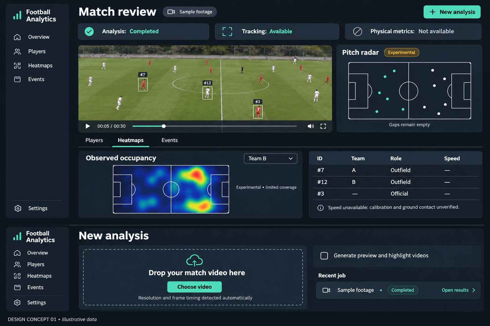

# Dashboard concept 01 — professional coaching tool

Visual exploration, pending user review. Generated with the built-in image-generation tool.
This is a static design mockup, not implemented frontend code. All footage, dots,
heatmap intensity and player rows in the image are illustrative, not measured results.

Direction: dark navy/charcoal, restrained teal, video-centered match review with
adjacent radar; heatmaps and player records below. Separate upload view with optional
media generation off by default. Preserve quality labels and unavailable statistics.
The geometry of drawn pitches and any fictional player associations in this image
are not implementation references; use the existing renderer and actual records.

Next: collect design feedback before implementing Step 10. Layout, colors and
components can be revised. Keep successive concepts as separate versions.

## Generation prompt

Use case: ui-mockup. Create a high-fidelity visual concept board for the Football Analytics desktop web app, professional coaching/analysis tool. This is a DESIGN MOCKUP ONLY, not real results. Landscape composition with two flat, front-on desktop interface screens stacked vertically, dominant large MATCH REVIEW screen taking upper 70 percent and smaller simplified NEW ANALYSIS screen lower 30 percent. Crisp highly legible Inter-like typography, exact readable English labels, disciplined alignment, generous whitespace, charcoal/navy background #101722, slightly lighter panels #182433, restrained teal accent #55C6B7, muted white text. No neon, no gradients, no device frames, no perspective, no sports marketing slogans. Small page caption 'DESIGN CONCEPT 01 • Illustrative data'. Main screen: slim left sidebar with Football Analytics wordmark and navigation Overview, Players, Heatmaps, Events, bottom Settings. Header 'Match review' with subtle 'Sample footage' chip and New analysis button. Three restrained status cards 'Analysis: Completed', 'Tracking: Available', 'Physical metrics: Not available'. Central large video panel showing generic illustrative football footage from high sideline with a few red/white player boxes and small local ID labels, media timeline with 00:05 / 00:30. To its right a smaller elegant tactical pitch panel headed 'Pitch radar' with 'Experimental' amber badge, sparse dots and tiny 'Gaps remain empty' caption. Below video: tab row Players / Heatmaps / Events with Heatmaps selected, attractive tactical pitch occupancy preview with small localized blue-yellow-red patches, 'Observed occupancy' title, 'Team B' dropdown, 'Experimental • limited coverage' caption. To right a compact player table with columns ID, Team, Role, Speed; rows #7 A Outfield —, #12 B Outfield —, #3 — Official —. Note 'Speed unavailable: calibration and ground contact unverified'. No numeric physical speeds, no fake tackle counts, no invented verified performance stats. Bottom smaller upload screen labeled 'New analysis': compact dashed upload dropzone 'Drop your match video here', teal 'Choose video' button, supporting text 'Resolution and frame timing detected automatically', a clearly unchecked checkbox 'Generate preview and highlight videos', a subtle recent-job row 'Sample footage • Completed • Open results'. Make both screens visually coherent and usable. Final image should look like an excellent polished Figma design presentation, with large enough labels to review layout.
