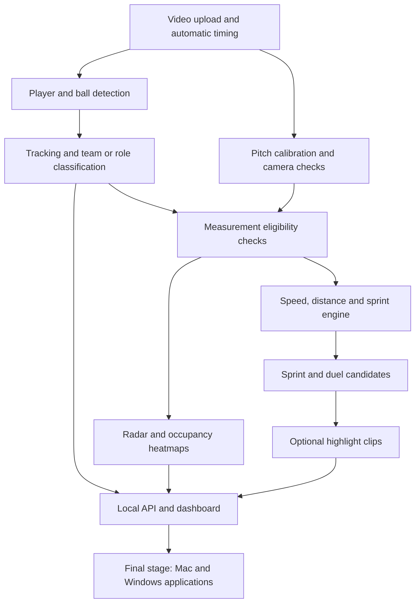
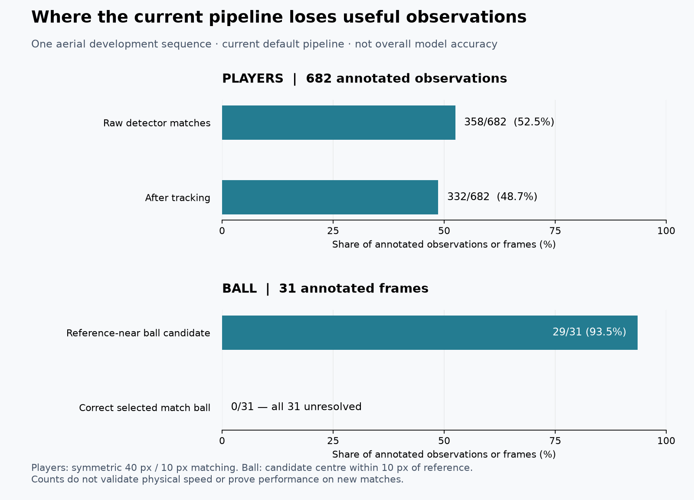

# Football Analytics — complete project status

Updated November 13, 2026. We have a functioning local research prototype, not yet a dependable coaching product. Software engineering has reached Step 11; the accuracy work in Steps 4–7 remains open. No honest single “percent complete” covers both software implementation and validated performance.

## Intended product

Upload a football video and automatically obtain player/ball observations, team and role labels, tracking, pitch mapping, reliable movement statistics where supported, tactical maps, and eventually useful events/highlights. The user should not have to measure video dimensions or supply pixel coordinates. Smartphone footage is an intended research/application scenario, not a validated capability across phone models or recording conditions.

Mac and Windows applications are the final packaging stage, after the model and local system are reliable. The current interface is a local browser dashboard. No native desktop installer or hosted multi-user product has been delivered.

## How the parts connect

A failure early in this chain affects later results. Better-looking charts cannot repair missed players, incorrect IDs or uncertain ground contact.

## What has been built

| Step | Implemented | What still needs work |
| --- | --- | --- |
| 1. Foundation | Python package, configuration, coordinate contracts, command-line tools, tests | Maintenance and release packaging |
| 2. Video input | Metadata, automatic resolution, timestamp-aware decoding, cut/gap handling | More codecs and devices in real-world validation |
| 3. Calibration | Automatic pitch landmarks, homography, camera updates, full-pitch overhead paint checks | Partial/obstructed views, real scale, cross-shot orientation, generalization |
| 4. Detection/tracking | Football detector, tiled high-resolution inference, local IDs, duplicate suppression, confidence-priority association, temporal ball selection | Missed players, false candidates, match-ball ambiguity, ID continuity |
| 5. Classification | Kit-color clustering, Team A/B, player/official/goalkeeper roles, unknown states | Similar kits, changing light, occlusion, role errors and stable athlete identity |
| 6. Telemetry | Speed, observed distance and sprint calculation engines with temporal/quality gates | Independently validated physical trajectories and ground contact |
| 7. Tactical outputs | Current-frame radar, team/local-track occupancy maps, timestamp weighting and gap handling | Useful continuous coverage and verified positions; occupancy is not possession |
| 8. Events/highlights | Sprint and duel candidate rules, clip planning, opt-in extraction and viewer | Real event accuracy; confirmed tackles, possession and counterattacks are not implemented |
| 9. Backend | Authentication, upload, durable queue, worker, progress, cancellation/retry, indexed queries and media | Broader runtime/storage controls and multi-user deployment design |
| 10. Dashboard | Overview, Players, Heatmaps, Events, upload/job controls, quality diagnostics | Further usability checks, richer exports/charts and reliable underlying metrics |
| 11. Deployment/validation | Local supervision, worker status, admission limits, disk/resolution checks, evaluation scripts | Training/evaluation data, compute/output quotas, retention, installers and release qualification |

## Tools and methods used

The analysis is primarily Python: a pinned Ultralytics football detector and pitch model, OpenCV image/geometry operations, NumPy/SciPy calculations and assignment, and PyAV timestamp-aware video handling. Tracking combines motion and appearance; team classification uses torso-color evidence. Homographies map image locations to the assumed pitch plane. The default pitch is explicitly 105 × 68 metres, not a size inferred reliably from the recording.

The local backend uses FastAPI and SQLite. React, TypeScript and Vite provide the dashboard. Tests check software contracts and failure handling. GitHub holds source, documentation and evaluation summaries; large videos, model weights and local job data are ignored. New model weights have not been trained during the recent repair passes.

## What the experiments actually established

### Players

High-resolution tiling improved a small earlier aerial comparison, but coverage remained insufficient. A later confidence-priority tracker repair improved matched observations from 330 to 332/682, eligible links from 206 to 208/660, and adjacent measured ID switches from one to zero. Longest eligible continuity remained about 1.80 seconds; no player reached two seconds in that diagnostic.

The latest consistent comparison found 358/682 raw detector matches versus 332/682 after tracking. Missing/ambiguous references stay in the denominator. This points primarily to detector-level coverage, although tracking also loses useful observations. These are aggregate stage counts; the difference does not prove that precisely 26 identical true detections were discarded. Unmatched outputs can include officials/nonparticipants absent from the reference labels.

### Ball

The small broadcast review contained a white turf object repeatedly detected next to the ball. Temporal selection chose the real ball in two of three reviewed competing frames, abstained in one, and selected none of the three reviewed turf candidates. Six other-recording ball controls were retained. Both recordings informed development.

The broader aerial check was worse: a ball candidate near the reference exists on 29/31 frames, but the current selector leaves all 31 unresolved. That is not 93.5% reliable ball tracking: having a correct candidate somewhere in a list is very different from identifying it as the match ball. Pitch-region screening and wider motion association produced wrong selections without correct ones, and were rejected. Neither is enabled by the production pipeline.

### Physical measurements and tactics

Speed depends on correct positions, identities and timestamps. Pixel jitter, camera motion, calibration scale, airborne feet and occlusion can all corrupt it. Synthetic tests prove calculation behavior under controlled inputs; they do not certify real athlete speed. Experimental position/heatmap outputs are explicitly labeled, strict unverified physical measurements stay unavailable, and gaps are not filled with fabricated motion. There is no validated tackle count or possession percentage.

## Current training-data work

A new audit examines the pinned SoccerTrack annotation table: 900 frames, 19,800 player observations and 900 ball observations. Of the player boxes, 16,938 (85.55%) are exactly 39×39 pixels. Repeated dimensions alone do not prove bad labels, but tight-box suitability must be visually reviewed before using them as detector-training targets. The table also lacks exhaustive officials/nonparticipant labels for the full person class.

A new split validator rejects a match or identical source appearing across train/validation/test partitions, incomplete target annotation declarations, and unreviewed box semantics. It validates declared metadata, not label truth or unknown overlap with pretrained-model data. It does not yet export a YOLO training dataset or start training.

External data options were checked against primary sources on November 13:

- [SoccerTrack v2](https://github.com/AtomScott/SoccerTrack-v2) describes multiple full-pitch matches and MOT/GSR/BAS annotations. Its [Hugging Face files](https://huggingface.co/datasets/atomscott/soccertrack-v2/tree/main) currently require account agreement before file access. Its format/version details still need checking against actual downloaded files.
- [SoccerNet Tracking](https://www.soccer-net.org/tasks/tracking) covers players, goalkeepers, officials, staff and balls. [Protected video access](https://www.soccer-net.org/data) requires the dataset access process/NDA where applicable. No agreement was accepted on the user's behalf.

No new footage was downloaded or model trained in this audit. Model accuracy has not improved as a result of adding these checks; they prepare a reproducible next training/evaluation stage.

## Remaining work, in practical order

1. **Prepare suitable data.** Obtain representative broadcast/phone/overhead sequences; verify annotation completeness, box meaning, timing and rights; split by match before tuning. Include officials, spare balls, white turf objects, blur, occlusion and genuine stationary-ball periods.
2. **Improve detection and match-ball selection.** Compare candidate detector weights or fine-tuning against a frozen baseline. Measure both missed objects and false positives, latency and memory. Evaluate on an untouched recording, not only the development footage.
3. **Recheck tracking/classification.** Measure identity continuity/switches and team/role accuracy, including same-team crossings and returning athletes. Do not equate fewer IDs with correct identities.
4. **Validate physical telemetry.** Obtain a suitable independent reference with uncertainty; report position/speed errors together with coverage. Establish what recording conditions support usable measurements.
5. **Validate/add football events.** Check sprint/duel candidates against event labels. Implement confirmed tackles/possession only with adequate ball and interaction evidence; current proximity rules are insufficient.
6. **Finish local product reliability.** Add storage lifecycle controls, runtime budgets, recovery and device/codec checks; refine the dashboard and exports with real usage.
7. **Package Mac and Windows last.** Resolve platform differences (including the current Unix-specific worker lock), bundle dependencies/models appropriately, test acceleration/fallback and installers, review distribution licenses, and qualify signed releases. A wrapper alone would not solve model errors.

Your proposed smartphone research study fits this plan: compare the same actions under controlled camera conditions and quantify both accuracy loss and the fraction of useful outputs. These numbers have not yet been measured. “Useful to people” should be assessed per task—team positioning may tolerate errors that make individual peak speed unsuitable.

## Product assessment

This is a credible research prototype and a useful platform for conducting the study. It is not ready to promise accurate coaching statistics on arbitrary uploads. The hardest remaining work is data quality and validated model performance, rather than adding more dashboard screens. Progress should be judged by independently measured accuracy/coverage and usable outputs, not test count or number of features.

At this report update, the existing 208-test suite had passed; the three new data-readiness tests also passed. Frontend build and three frontend tests passed at the previous frontend change. No fresh video was generated for this report.
